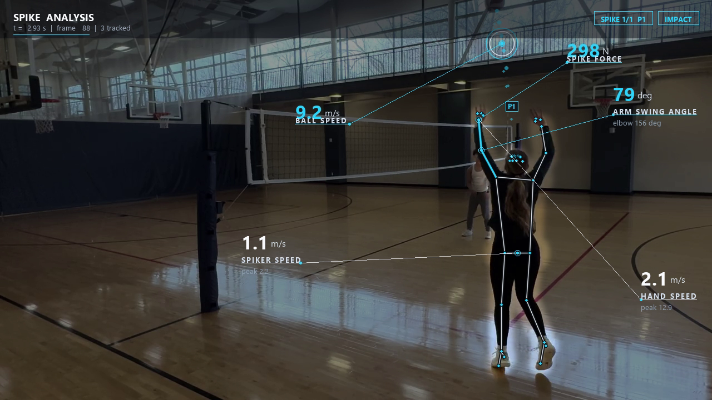

# volleyball-motion-tracker

Multi-person volleyball attack analysis with pose tracking, ball tracking,
kinematic estimates, and an annotated HUD overlay.

Every visible player is tracked across the clip. When a player attacks, the
overlay highlights them, labels the attack (spike / tip / roll), and reports
the arm-swing, jump, and ball-impact kinematics. Sets and overhand passes are
rejected — an attack needs a downward arm swing or a forward-driven ball, not
a ball lofted straight back up. A clip can contain zero attacks (the tracker
still renders everyone), one, or many — each is analyzed independently.



*`volleyball_spike_attempt_03.mp4` at the moment of contact: the attacker is
spotlighted, the swing is labeled a spike, and arm-swing, hand-speed, and
ball-impact metrics are drawn around them.*

## Stack

MediaPipe (pose), YOLOv8 (person + ball), OpenCV, Pillow, NumPy

## How it works

1. **Detect** — each frame, a single YOLO pass finds every player's bounding
   box and the ball. Players are tracked into stable identities across frames.
2. **Find attacks** — a box/ball selector flags frames where a tracked
   player's upper body meets the ball and the ball leaves with attack-like
   velocity. Thresholds are in ball-radii per frame, so they hold across
   720p/1080p/4K. Surviving events are classified spike, tip, or roll from
   ball-exit speed and wrist motion at contact.
3. **Refine + measure** — MediaPipe Pose is run at high fidelity on just the
   attacking players' frames, then arm-swing angle, hand speed, jump height,
   jump force, and spike force on the ball are computed per event.
4. **Render** — every player is drawn; the active attacker is highlighted with
   their analytics HUD. Frames with no attack still show the full tracking.

## Run

```bash
pip install -e .
volleyball-tracker test_videos/volleyball_spike_attempt_02.mp4
```

By default, rendered videos are written to `output_videos/volleyball_spike_performance_analysis_<input>.mp4`.
You can still pass an explicit output path:

```bash
volleyball-tracker test_videos/volleyball_spike_attempt_02.mp4 output_videos/volleyball_spike_performance_analysis_attempt_02.mp4
```

## Options

- `--height` / `--mass` — athlete height (m) and mass (kg) for more accurate
  scale and force estimates.
- `--single-person` — use the legacy full-frame MediaPipe-only detector.
  Faster on single-spiker practice clips, but misses most players on
  wide-angle game footage. The default is the multi-person detector.
- `--max-people N` — cap how many players are tracked per frame (default 14).
- `--model` / `--imgsz` / `--device` — ball/person detector weights, inference
  size, and device (`cuda`, `mps`, or `cpu`; auto-detected by default).
- `--roi` — ROI-tracked ball inference (faster; intended for live mode).
